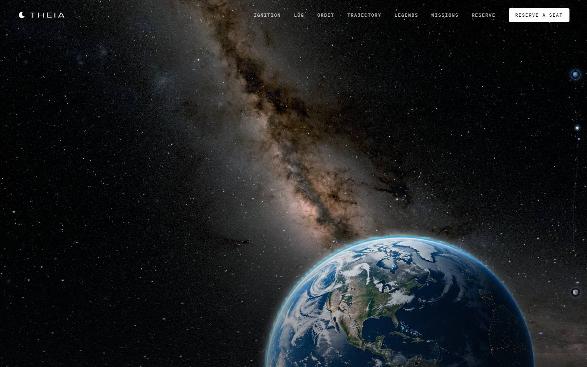
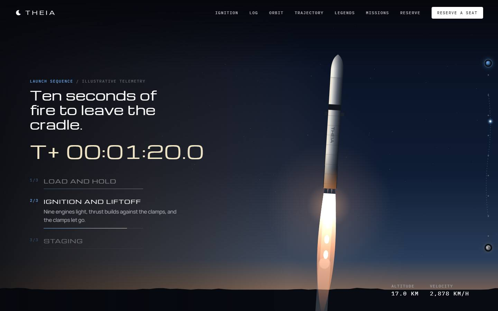
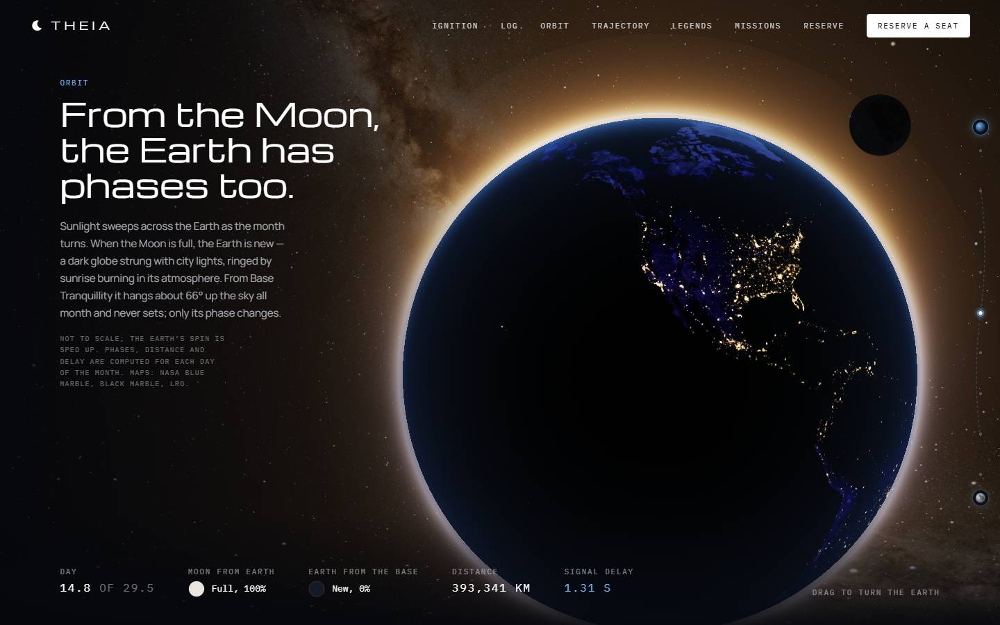
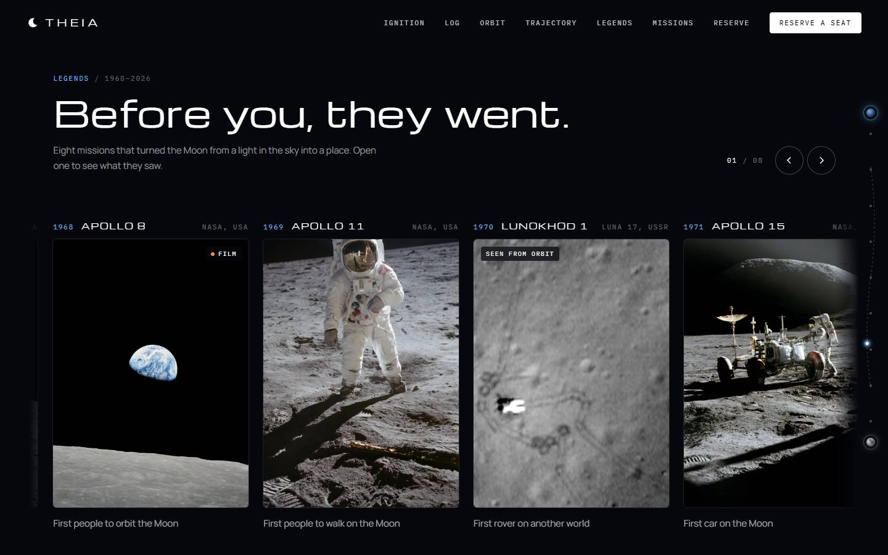
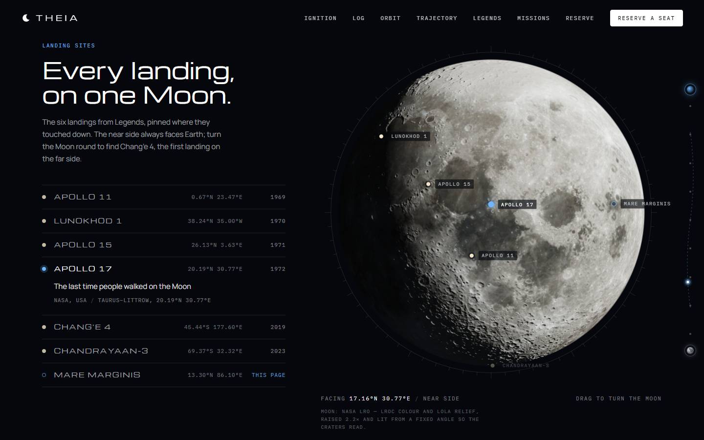
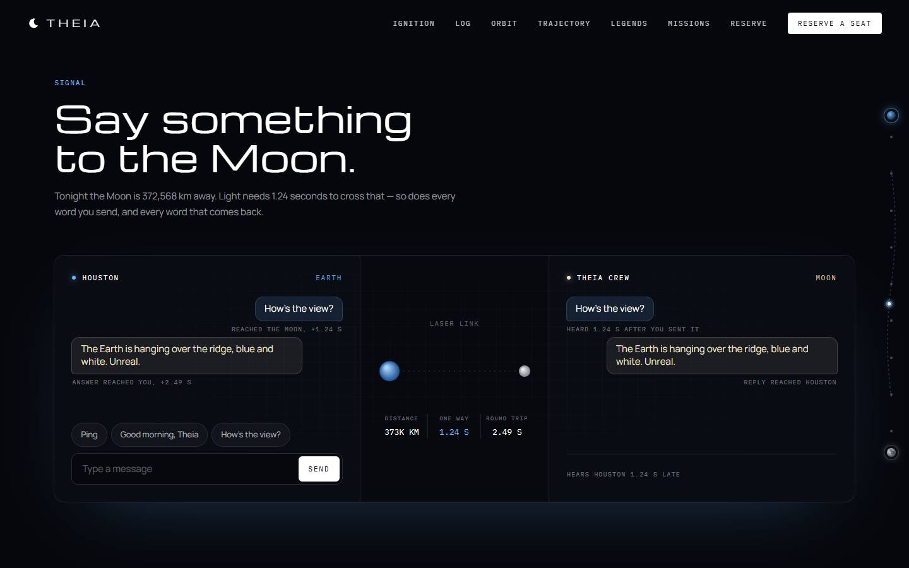

<p align="center">
  
</p>

<h1 align="center">THEIA</h1>

<p align="center">
  <b>Watch the Earth rise.</b><br />
  A scroll-driven journey to the Moon, built from real astronomy and real NASA data.
</p>

<p align="center">
  <a href="https://theia-engine-alpha.vercel.app/"><b>▶ &nbsp;See it live</b></a>
</p>

<p align="center">
  React · TypeScript · Vite · Tailwind · hand-written WebGL
</p>

<br />

## The idea

THEIA is a landing page for a lunar-travel company that doesn't exist.

You scroll, and the page takes you from the launch pad to the Moon and back to the Earth. Along the way it tries to be *true*: the Moon's phase, the distance to it, and the time a radio message takes to reach it are all worked out from today's date, not made up.

It's a concept, so there are no seats, launches or payments. What's real is everything you look at.

<br />

## Where it started

This project began with someone else's good idea.

[**Scrolltide**](https://www.scrolltide.co/) makes scroll-driven website templates, and their free **[Selene](https://www.scrolltide.co/templates/selene)** template had a lovely premise: dust clears off the Moon, the Earth rises over the horizon, and a line draws itself across 384,400 km as you scroll.

It showed that a landing page can be a journey instead of a stack of sections. We loved it, and we owe the spark to them. Thank you, Scrolltide, for proving the idea. If this kind of work excites you, their [library](https://www.scrolltide.co/) is worth an afternoon.

<br />

## Where we took it

Then we asked a different question: *what if every part of the trip was real?*

<br />

### First, leave the ground



A rocket launch at dusk, played by your scroll wheel. Scroll back and the smoke un-billows. Booster separation, the sky going black, the curve of the Earth coming up.

<br />

### Then see the Earth the way the Moon does



As you scroll, the Sun swings round through a whole lunar month. At full Moon the Earth goes *new*: a dark globe of city lights, ringed by sunrise burning in its atmosphere. The phases on screen are calculated, and the stars behind are NASA's real map of the sky.

<br />

### Meet the people who got there first



Eight real missions, from Apollo 8 to Artemis II, as cards you can drag. Open one and it unfolds into the story, with the real photographs and credits.

<br />

### Find where they landed



Every landing, pinned at its true coordinates on a 3D Moon built from NASA's laser-mapped terrain. Spin it, pick a site, and the Moon turns to show you. Chang'e 4 sends you round to the far side.

<br />

### Say hello



Message the crew on the Moon. Radio travels at the speed of light, so they hear you about 1.25 seconds later, and their answer takes just as long to come back. You can *watch* the delay. (The crew's replies are scripted; the delay is real.)

<br />

And at the very bottom, the Earth as it looks from the Moon **tonight**, worked out in your browser. There's also a personal flight plaque you can engrave with your name and hear as a chord.

<br />

## What makes it feel real

A few ideas carry the whole project:

- **Scroll is the timeline.** Everything is drawn from how far you've scrolled, not from timers, so it plays forwards and backwards smoothly.
- **One animation loop.** The whole page shares a single loop and updates the screen directly, so React stays out of the way and the scroll stays smooth.
- **Real maths, small and honest.** Moon phase, distance and signal delay come from astronomical formulas. Anything approximate is labelled approximate.
- **Real data.** NASA's Moon and Earth maps, mission photos, and the Gaia star survey, turned into web-sized images by scripts in this repo.
- **Built to be used by everyone.** It respects reduced-motion settings, works with a keyboard and screen readers, and has fallbacks where WebGL isn't available.

<br />

## Built with

| | |
|---|---|
| **App** | React 19, TypeScript, Vite |
| **Styling** | Tailwind CSS v4 |
| **Scrolling** | Lenis |
| **3D** | WebGL2 with hand-written shaders (no 3D library) |
| **Hosting** | Vercel |

No GSAP, no Framer Motion, no animation library at all.

<br />

## Run it yourself

```bash
git clone https://github.com/argh-finds404/theia-engine.git
cd theia-engine
npm install
npm run dev
```

Then open **http://localhost:3000**.

To make a production build, run `npm run build`.

<br />

## Credits

- **Inspiration and starting point:** [Scrolltide's Selene](https://www.scrolltide.co/templates/selene). The hero artwork comes from their template.
- **Space data:** NASA — Lunar Reconnaissance Orbiter, Blue Marble, Black Marble, the Scientific Visualization Studio's Deep Star Maps, and mission photography. Gaia star data: ESA/Gaia/DPAC.

<br />

<p align="center">
  <sub>THEIA is a design concept. The company, the missions on offer and the crew's replies are fictional.</sub>
</p>
